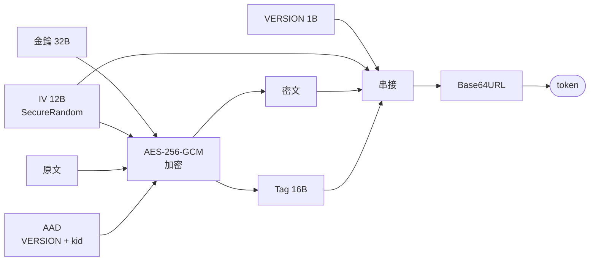
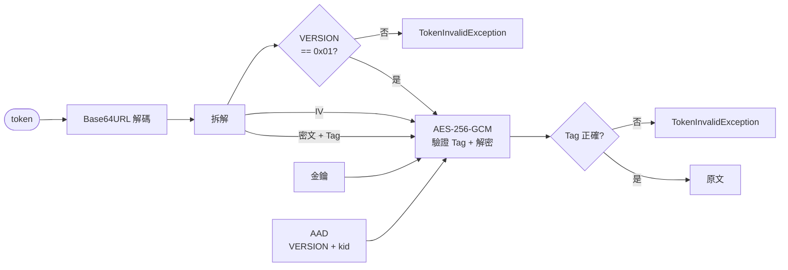
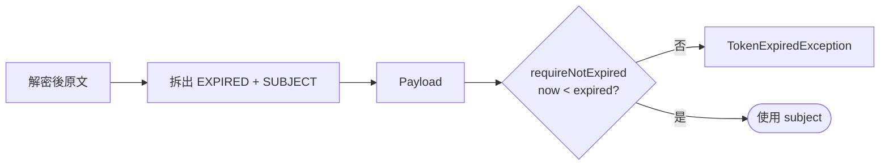

# AesGcmHelper

AES-256-GCM 加解密工具，可選擇把到期時間一起封進密文。
全 `static` method、零外部依賴、單一檔案可直接 copy 進既有專案。

> 原始碼：[`AesGcmHelper.java`](../java/src/main/java/io/github/cboheng/commontools/crypto/AesGcmHelper.java)　測試：[`AesGcmHelperTest.java`](../java/src/test/java/io/github/cboheng/commontools/crypto/AesGcmHelperTest.java)

---

## 一、AES-256-GCM 背景

| 名詞 | 說明 |
|---|---|
| **AES** | 對稱式區塊加密演算法，加解密用同一把金鑰。**256** 指金鑰長度 256 bits（32 bytes）。 |
| **GCM** | Galois/Counter Mode，AES 的一種運作模式：用 counter 模式加密，同時用 GHASH 算出認證標籤（tag）。 |
| **AEAD** | Authenticated Encryption with Associated Data。GCM 屬於這類：**加密＋防竄改一次完成**，密文被改一個 bit 就解不開。 |

為什麼選 GCM 而不是 CBC：CBC 只加密、不認證，要自己外掛 HMAC，順序或比較方式做錯就會出現 padding oracle 之類的漏洞。GCM 內建認證，用起來不容易出錯。

使用 GCM 唯一的鐵則：**同一把金鑰下 IV 絕不能重複**。本工具每次加密都用 `SecureRandom` 產生新的 IV，所以同一份資料加密兩次會得到不同結果——這是正確行為。

參考規格：
- [NIST FIPS 197 — AES](https://csrc.nist.gov/pubs/fips/197/final)
- [NIST SP 800-38D — GCM](https://csrc.nist.gov/pubs/sp/800/38/d/final)
- [RFC 5116 — AEAD 介面](https://www.rfc-editor.org/rfc/rfc5116)

---

## 二、使用範例

### 準備金鑰

<details>
<summary>Java</summary>

```java
// 產生一把新金鑰（只做一次，存進 KMS / 環境變數，不要 commit）
String base64Key = KeyRef.generate("2026-10").keyToBase64();

// 應用程式啟動時載入
KeyRef keyRef = KeyRef.ofBase64(
        System.getenv("TOKEN_ENCRYPTION_KEY"),   // AES-256 金鑰的 Base64
        System.getenv("TOKEN_ENCRYPTION_KID"));  // 金鑰識別碼，例如 "2026-10"
```

</details>

`kid` 必須加解密兩端一致，否則一律解不開。改 kid 等於讓所有已發出的 token 失效。

### 一般加解密

<details>
<summary>Java</summary>

```java
byte[] plaintext = "任意資料".getBytes(StandardCharsets.UTF_8);

String token    = AesGcmHelper.encrypt(plaintext, keyRef);
byte[] restored = AesGcmHelper.decrypt(token, keyRef);
```

</details>

### 時效性加解密

<details>
<summary>Java</summary>

```java
// 發行：15 分鐘後失效
String token = AesGcmHelper.encryptPayload(
        Payload.validFor("user-42", Duration.ofMinutes(15)), keyRef);

// 驗證
try {
    Payload payload = AesGcmHelper.decryptPayload(token, keyRef)
            .requireNotExpired(Instant.now());   // ⚠️ 不接這行就不會檢查時效
    String subject = payload.subject();          // "user-42"

} catch (AesGcmHelper.TokenExpiredException e) {
    // token 是真的，但過期了 → 請使用者重新取得
} catch (AesGcmHelper.TokenInvalidException e) {
    // 格式錯 / 被竄改 / 金鑰或 kid 不符 → 拒絕，不要回傳細節
}
```

</details>

輸出的 token 是 URL-safe Base64，可以直接放進 query string、header、cookie。

---

## 三、各項資料

| 資料 | 長度 | 來源 | 在 token 裡？ | 說明 |
|---|---|---|---|---|
| 金鑰 (Key) | 32 bytes | `KeyRef` | ❌ | 加解密兩端共用，絕不外流 |
| kid | 任意 | `KeyRef` | ❌ | 金鑰識別碼，透過 AAD 參與認證 |
| 版號 (VERSION) | 1 byte | 固定 `0x01` | ✅ 明文 | 對齊加解密兩端的程式版本：解密端依它決定如何解析 token，版本不符即拒絕 |
| IV / nonce | 12 bytes | 每次 `SecureRandom` | ✅ 明文 | 讓相同明文每次產生不同密文；不需保密，但不可重複 |
| 原文 (Plaintext) | n bytes | 呼叫端 | ❌ | 時效模式下是 `到期時間(8) + subject(UTF-8)` |
| 密文 (Ciphertext) | n bytes | AES-CTR 輸出 | ✅ | 長度 = 原文長度（GCM 不需 padding） |
| 認證標籤 (Tag) | 16 bytes | GHASH 輸出 | ✅ | 驗證密文與 AAD 沒被改過 |
| AAD | 1 + kid 長度 | `VERSION + kid` | ❌ | 不加密但納入認證；兩端各自算出，不隨 token 傳輸 |

### Token 格式

```
Base64URL( VERSION(1) | IV(12) | CIPHERTEXT(n) | TAG(16) )

時效模式下，原文的結構（解密後才看得到）：
    EXPIRED(8, big-endian epoch milli) | SUBJECT(UTF-8)
```

### 實例

`subject = "user-42"`、`expired = 2026-10-06T09:00:00Z`、`kid = "2026-10"`：

```text
Token : AQZTPI41kFEsYEBPcJ1OLLBqB7AtofP7ZrRwEztDHsWUm26mBWTwzyHSz3A   (59 字元 / 44 bytes)

VERSION    [0]       1 byte  : 01
IV         [1..13)  12 bytes : 06533C8E3590512C60404F70
CIPHERTEXT [13..28) 15 bytes : 9D4E2CB06A07B02DA1F3FB66B47013
TAG        [28..44) 16 bytes : 3B431EC5949B6EA60564F0CF21D2CF70

AAD = 01 || "2026-10" = 01323032362D3130   （不在 token 裡）

解密後的原文（15 bytes）：
EXPIRED [0..8) : 000001A11070F280 = 2026-10-06T09:00:00Z
SUBJECT [8..]  : 757365722D3432   = "user-42"
```

IV 每次都不同，所以自己跑出來的 token 不會一樣。

---

## 四、加解密流程

### 加密



### 解密



### 時效模式額外步驟



`decryptPayload` 只負責第一步（解密 + 拆解），是否過期由呼叫端明確呼叫 `requireNotExpired` / `isExpired` 判斷。
